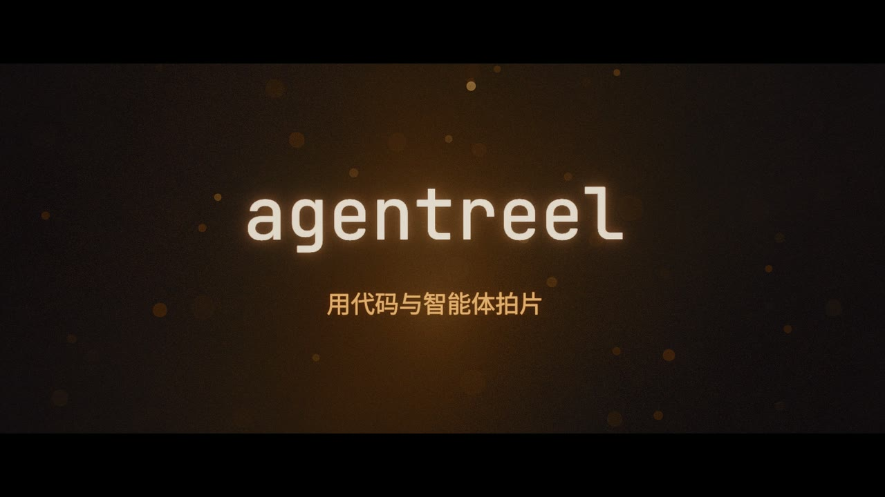
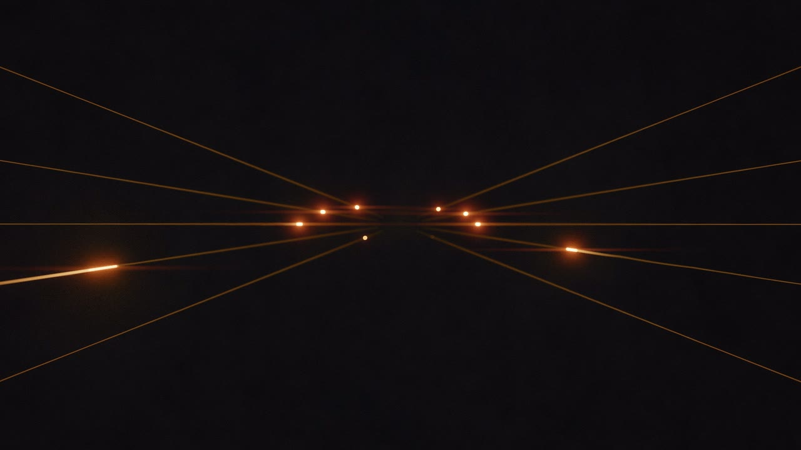
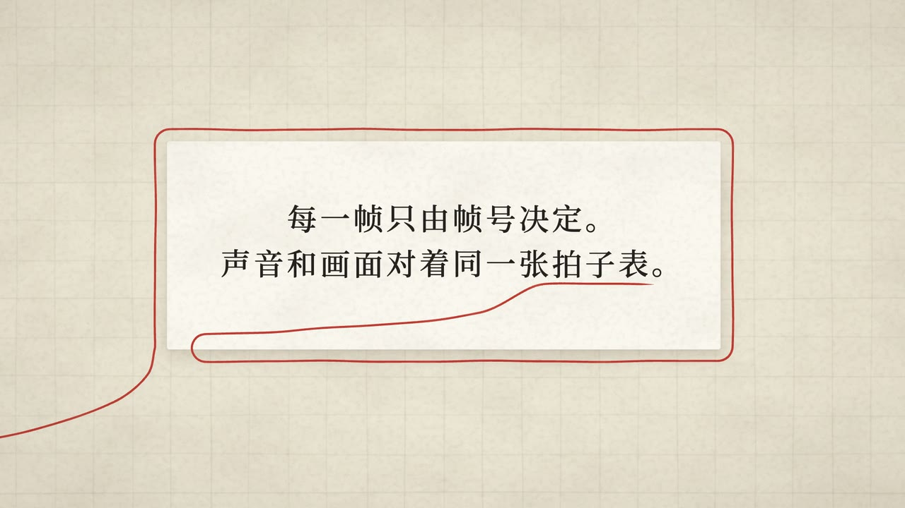
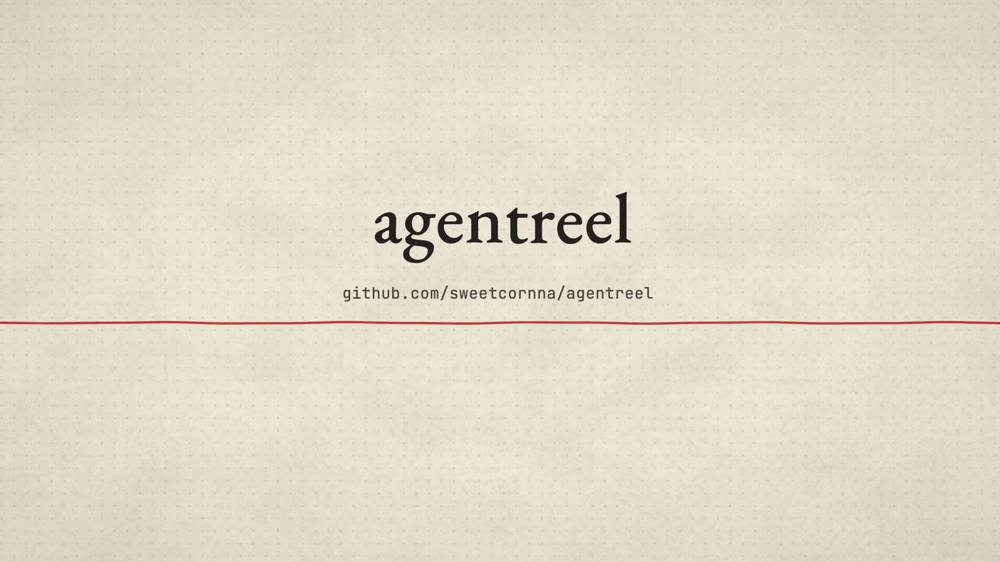

# agentreel

**一位负责人加一组 AI 智能体，用代码拍短片。** 画面逐帧由程序渲染，配乐由代码合成或用公开许可的采样拼成，画面和声音对着同一张拍子表。这里是从三部真实宣传片的制作中整理出来的两套渲染引擎、两套配乐库、两部可以直接跑的示例片，以及完整的制作方法。

*Make short films with code and AI agents: deterministic frame-by-frame renderers (three.js / React) driven from headless Chrome, procedural and sampled film scoring in Python, one shared beat grid, and the production method (bible → timeline → task briefs → review rounds → QA gates) used on three real promo films.*

| 《光与弦》（`films/demo-light`，beat3d + filmsynth） | |
| --- | --- |
|  |  |
| **《纸上一线》（`films/demo-paper`，paper2d + sampler）** | |
|  |  |

## 里面有什么

| 目录 | 是什么 |
| --- | --- |
| [`engines/beat3d/`](engines/beat3d/) | 三维光影引擎：Bun + TypeScript + three.js 自写渲染器，无头 Chrome 多标签出帧，ffmpeg 编码。可换形状的光圈虚化、分层景深、体积雾、光聚成字 / 字化为光、AgX 胶片后期、按乐谱事件驱动画面。移植自《一拍》与《成路》 |
| [`engines/paper2d/`](engines/paper2d/) | 纸面二维引擎：React 场景按 Remotion 风格的 API 写，由自写的兼容子集（垫片）打包，无头 Chrome 截帧；纸面、铅笔线、红线穿引、逐字字幕。不安装任何视频框架。移植自阡陌宣传片 |
| [`music/filmsynth/`](music/filmsynth/) | 纯代码合成的配乐库（Python）：拨弦、弓弦、毛毡钢琴、管风琴、合唱、钟、鼓、气流……不用任何录音；从时间线写谱，导出 `score.wav`、分轨与给画面读的 `events.json`；带通用自检 |
| [`music/sampler/`](music/sampler/) | 采样乐器 + 经典 DSP 的配乐库（Python）：钢琴、弦乐、民谣乐器、人声、自然声……采样不入库，[`fetch_samples.py`](music/sampler/fetch_samples.py) 从原始出处下载并逐条核对许可（只收 CC0 / 公有领域 / CC BY） |
| [`films/demo-light/`](films/demo-light/) | 示例片《光与弦》，24 s，beat3d + filmsynth |
| [`films/demo-paper/`](films/demo-paper/) | 示例片《纸上一线》，23.3 s，paper2d + sampler（只用 CC0 采样） |
| [`docs/`](docs/) | 制作方法、时间线规范、验收闸门、模板、三部片的案例 |

一部片就是 `films/<名字>/` 一个目录：`timeline.json`（唯一的时间来源）+ 场景代码 + 乐谱 + README。引擎和配乐库不含任何一部片的内容，输出写到片目录的 `out/`。

## 快速开始

需要：[Bun](https://bun.sh)，Python 3.12，[uv](https://docs.astral.sh/uv/)（sampler 用），ffmpeg，Google Chrome。目前只在 macOS（Apple 芯片）上完整验证过；Linux、Windows 的路径查找与 GPU 预设已写好但未实测。找不到时用环境变量指定：`CHROME_PATH`、`FFMPEG`、`FFPROBE`；GPU 后端见各引擎 README（`BEAT3D_GPU`、`PAPER2D_GL`）。

先渲配乐，再渲画面。beat3d 构建时读配乐导出的 `events.json`，让画面跟着乐谱事件动；没有配乐也能出无声片，按拍网格走。paper2d 不读 `events.json`，配乐只在最后混进成片。

下面的命令都在仓库根目录执行（进子目录的步骤用括号包成子 shell，执行完仍回到根目录）。

### 《光与弦》：beat3d + filmsynth

```sh
# 配乐（首次运行 numba 编译约 40 s）
(cd music/filmsynth && python3.12 -m venv .venv && .venv/bin/pip install -r requirements.lock.txt)
music/filmsynth/.venv/bin/python films/demo-light/score/score.py     # → films/demo-light/out/music/

# 画面（--film 默认就是 demo-light）；check-determinism 用两个页面、不同顺序渲同一批帧，逐字节比较
(cd engines/beat3d && bun install && bun scripts/render.ts --size 1080 && bun scripts/check-determinism.ts)
```

成片在 `films/demo-light/out/demo-light-1080p.mp4`，已混入配乐（1080p 母版码率高，24 s 约 200 MB）。

### 《纸上一线》：paper2d + sampler

```sh
# 配乐：建环境、按清单下载 40 个 CC0 采样（约 155 MB；GitHub raw 较慢，实测约 10 分钟，频繁重试时设 GITHUB_TOKEN），渲染并自检
uv venv --python 3.12 music/sampler/.venv
uv pip install --python music/sampler/.venv -r music/sampler/requirements.lock
uv pip install --python music/sampler/.venv --no-deps -e music/sampler
music/sampler/.venv/bin/python music/sampler/fetch_samples.py --files films/demo-paper/score/samples.txt
music/sampler/.venv/bin/python films/demo-paper/score/score.py --check  # → films/demo-paper/out/music/

# 画面并混音
(cd engines/paper2d && bun install && bun render.ts --film ../../films/demo-paper --audio ../../films/demo-paper/out/music/score.wav)
```

成片在 `films/demo-paper/out/DemoPaper_audio.mp4`（无声版 `DemoPaper.mp4`）。

ffmpeg 需要带 libx264。逐帧预览、静帧、切点对账、跳变扫描、调色与响度检查等命令见各目录的 README。

## 怎么做一部新片

从 [docs/README.md](docs/README.md) 开始：

- [METHOD.md](docs/METHOD.md)：角色与流程。负责人定方向和审美；主会话写导演本、时间线和任务书，派发、审片、打回；子代理按任务书分路实现；每一轮只改该改的帧。
- [TIMELINE.md](docs/TIMELINE.md)：时间线与拍网格，`小节.拍+偏移` 的写法，`events.json` 怎么和网格对齐。
- [QA.md](docs/QA.md)：验收闸门，包括确定性、切点、跳变、PSNR / 哈希、调色档位、响度与真峰值、字幕可读时长。
- [templates/](docs/templates/)：导演本、任务书、交付报告、交接、审片打回的模板。

## 三部片

| 片子 | 路线 | 案例 |
| --- | --- | --- |
| 《一拍》ONE BEAT | beat3d 的前身 + filmsynth；14 镜、93 s，一条消息从「嘀」到「嗒」的慢镜头 | [docs/cases/yipai.md](docs/cases/yipai.md) |
| 《成路》MADE BY WALKING | beat3d 的祖先 + filmsynth 原版；七章七种笔法 | [docs/cases/chenglu.md](docs/cases/chenglu.md) |
| 阡陌宣传片 | paper2d + sampler；从 R1 到 U90 系列，约三十轮迭代 | [docs/cases/qianmo-promo.md](docs/cases/qianmo-promo.md) |

三部片的成片、镜头程序、乐谱、产品界面、参考资料和采样不在本仓库里，这里只有可复用的框架和方法。

## 原则

- 一帧只由帧号决定，一段音乐只由乐谱决定：同一台机器、同样的输入和参数，重渲逐字节（逐样本）一致。paper2d 是例外：它要求同样的 `--tabs`，而且整片偶有 1–2 帧差几个像素，见其 README。
- 时间线是唯一的时间来源，画面和配乐都从它换算，谁都不写死秒数或帧号。
- 每一轮只改该改的帧，其余用哈希、PSNR 或逐样本比较证明没变。
- 客观检查全过，只说明没做坏；好不好看、好不好听，要人来看、来听。

## 许可

- 代码：MIT，见 [LICENSE](LICENSE)。
- 字体：SIL Open Font License 1.1，许可文本随字体放在各自的 `fonts/` 目录。
- 采样：不随仓库分发，由 `fetch_samples.py` 下载，按各自许可使用。用到 CC BY 素材的成片公开时，必须带 [music/sampler/CREDITS.md](music/sampler/CREDITS.md) 里规定的署名。两部示例片只用了代码合成的声音和 CC0 采样。
