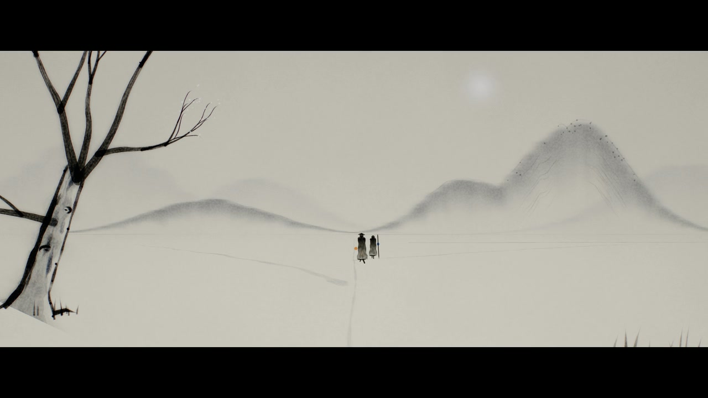
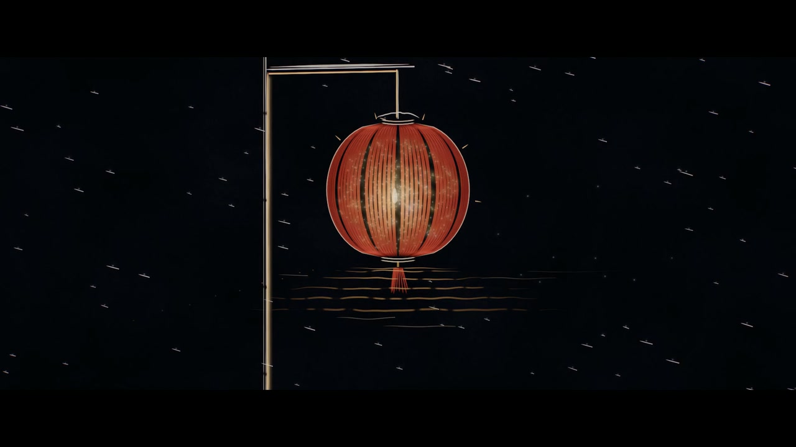

# 案例：《成路》MADE BY WALKING

阡陌（一个智能体网络项目）的宣传短片。题目借鲁迅《故乡》结尾「其实地上本没有路，走的人多了，也便成了路」：没有路的黑夜里，一点暖光独自走，脚印随走随灭；一点冷光来到它身边，踩着它的脚印走，脚印第一次留了下来；走的人越来越多，脚印成了阡陌；风雪吹灭了所有的灯，只剩一盏还在跳，它把光沿着雪下的路传出去，万盏灯依次回应；镜头一路升到星球之外，日出时晨昏线上全是路。

agentreel 的自写渲染器、确定性规则、「按目录切所有权、共享层只做加法」的分路方式和 filmsynth 配乐库，都是在这部片里第一次写成的。

*S10 四季，17.1+10f（第 1290 帧）。同一条路在四季、一天各时的八个景，构图完全一致，先每拍一切、再每八分音符一切；这是第一景，雪中水墨：宣纸底、焦墨与淡墨、远淡近浓，两个行者走在路上，路从画面下方通向线上的消失点。*

## 规格

| 项 | 数值 |
| --- | --- |
| 长度 | 40 小节 = 3200 帧 = 133.3 s（正片 36 小节 120 s，片尾字幕 4 小节） |
| 帧率与速度 | 24 fps，72 BPM 固定，每拍 20 帧、每小节 80 帧；尾声的放慢是「写出来的」，网格不动 |
| 画幅 | 画布始终 16:9；S01–S17 是 2.39 遮幅，S18 升空穿云时在 30.1–30.3 缓缓打开到 16:9，之后保持 |
| 贯穿的线 | 画面里有一条横线始终在 y = 0.588（1080p 下第 635 行），这是 2.39 可视区的黄金分割，画幅打开时线不动 |
| 计划母版 | 预览 1080p；终版 2160p，H.264 High CRF 14，音频 48 kHz / 24 bit |
| 实际进度 | 一天之内从导演本做到全片 1080p 动态分镜（全部镜头粗做到位、配定稿音乐，3200 帧）；4K 终版没有做 |

## 技术路线

**自写渲染器。** 负责人在开工当天要求不用 Remotion 一类视频框架，连同它们的 skill 一起从本机删除（理由是影响模型表现），于是写了一个只依赖 three.js 的渲染器：页面里 `renderFrame(n)` 渲完整一帧（含后期与遮幅），无头 Chrome 多标签并行取像素，经本地服务写进 ffmpeg，分段并行后无损拼接，最后混入配乐。

- 一帧只是帧号的纯函数；随机数按镜头 id 播种；不用累积模拟。走路成径（主动行者模型）这类模拟预先算好存在 `sim/` 下，按帧读取。
- 所有尺寸按 1080p 像素写，乘 `高 / 1080`。泛光、晕光、拉丝的金字塔在 4K 下多跳一级，让模糊半径占画面的比例不变（4K 缩到 1080 后与 1080p 帧的平均差 0.17 个码值）。
- 运动模糊用时间超采样：快门内取 N 个子帧分别调用 `frame(n + δ)`，HDR 结果平均后再走后期。天然确定，对一切运动都正确，代价是 N 倍 GPU 时间，所以只在快速镜头里开。
- 共享组件：夜空与星表、地形、角色光与步伐、脚印光痕、光笔（LightBrush：屏幕空间定宽、高斯核心加柔光晕，沿线可控起收笔、笔压、手颤、按弧长写出）、光点、色雾、等高线、文字与光丝。

**七章七种笔法。** 视觉方向在开工当天改了两次：负责人先要求「尽量减少写实 3D 效果展示」，于是有了「以光为墨」（黑暗是画布，世界只由线、点、粒子、光晕、色雾构成，线要有书法感）；接着又要求「风格多变」并「介绍功能」，于是有了全片画风总谱：光、墨、金、刻、星、色、晨七章，每章一种艺术媒介。同一支光笔加了墨模式（乘法叠墨、宣纸）、硬边（描金、刀刻）、逐点的宽度与浓淡，七种媒介共用一套笔刷。换画法都是镜头内的事件：光画负片翻成墨画正片、纸暗成漆、风雪的刀痕抽走金色、唯一的暖光流进线里化成点彩、点糊成色带、色带收成星球的大气。

*S15 最后一盏灯，25.4+10f（第 1990 帧）。「刻」那一章：风雪之后全片黑白，雪是斜着划过的白色刀痕，只剩这一盏灯笼是暖色，按心跳一明一灭。下一拍它骤亮，光沿竹杆流进雪下的路，画法转入点彩。*

**配乐（filmsynth 原版）。** 全部代码合成，不用录音、采样、外部冲激响应、生成模型。配器即角色：暖光是拨弦（扩展 Karplus-Strong，往古琴靠：木质、中低音区、软起音、不用泛音），冷光是箫（气声），大地与天空是管风琴（加法合成多音栓），众人是合唱（共振峰合成）与弦乐群。五声音阶 {D E F♯ A B}，前半以 B 为中心（羽），31.1 高潮把重心移到 D（宫）。

两个结构装置把画面和音乐绑在一起：

- **回声就是脚印。** 时间线里的「保留度」曲线 p 同时决定脚印光痕的半衰期（h = 0.4 s × 10^(3p)）和拨弦回声的反馈量（fb = 0.15 + 0.45p）。第一幕回声很快消散，路被忘掉；冷光来了以后反馈拉长，路留下了。
- **卡农就是同行，多速度卡农就是走的人多了。** 箫晚琴一小节模仿；之后同一动机在多个声部以 4 倍、2 倍、原速、一半的时值同时进行，在高潮和弦上会合。

*S19 晨昏线，31.3（第 2440 帧）。近地轨道上，太阳越过星球边缘，那条贯穿全片的线在这里是晨昏线，此刻最亮。夜面上的路网与城市光点用同一个走路成径模型在星球尺度上生成，大陆轮廓也是程序生成的。*

## 分路与轮次

| 角色 | 档位 | 范围 |
| --- | --- | --- |
| 编剧、分镜、音乐地图、风格、审计 | 主会话，最高档 | 导演本、分镜细化、音乐地图、风格总谱、时间线 |
| 参考片拆解 | 高档 | 只记方法和数字，画面与声音不入库 |
| 乐器与 DSP 工具库 | 高档 | `music/lib/`、乐器演示 |
| 作曲与配器 | 最高档 | `music/score/` |
| 画面管线与样张 | 高档 | 引擎骨架、共享组件、`sim/` |
| 分场制作（四路并行） | 高档 | A1 荒原与两光；A2 四季与阡陌生长；B 河谷与灯；C 升空、星球、品牌与片尾，各自的 `scenes/<路>/` |
| 盲测 | 新开，不给上下文 | 只看静帧，复述含义 |

里程碑：M1 拆解报告、导演本、两套工具库起步；M2 六张样张加一版完整的音乐小样；M3 1080p 动态分镜；M4 4K 终版、终混、审计和盲测。这部片停在 M3。

## 关键决策

- **先写音乐，后剪画面。** 剪辑表从乐谱派生：画面按乐句切，画面事件安排在音乐里本来就有事情发生的地方，不为了对点往音乐里硬塞音符。灯的级联、信的往来都按配乐导出的事件对时刻。
- **硬同步点只有 12 个**，全部在结构边界上，做法只有三种：某一层进入、某一层撤出、一记低频重拍。其余全是软同步。
- **叮当不能明显。** 负责人听过第一版后先说「不要用叮叮当当的声音」，随后补充「只要叮叮当当不要太明显就行」。于是主角和关键事件不再用叮当类音色（冷光改由箫来演，光标的嗒改成低而软的心跳），钟、玻璃、钢片琴退到底下只做颜色，并在自检里单独量它们比最响一层低多少。
- **响度跨度至少 25 dB，并留真正的静。** 24.3 风雪一刀切断，之后不少于 1.5 秒的近乎静默；16.1（片名）和 32.1 两处把次低频与低频撤出 18–20 dB 以上，只留高处的长音。
- **全部程序生成。** 不用图片、贴图、HDRI、生图接口；唯一的外部资产是 OFL 字体。制作声明照这个写，并保证为真。
- **按目录切所有权，共享层冻结、只做加法。** 每路只写自己的 `scenes/<路>/` 和 `sim/<路>/`；登记表只汇总、不需要改；同一镜头被两个程序认领直接报错。需要改共享组件时交「需求和理由」，主会话只加可选参数，不改默认值。
- **样张先行。** 每路第一步只交两三张静帧（1080p 一张、4K 一张），交完就停，等主会话审。

## 教训

- **盲测比自评可靠。** 盲测代理只看静帧，逐张写看到了什么、整片讲了什么、哪几张像游戏截图或屏保。读错的镜头先查画面，不先改字幕卡；被点名「像游戏截图」两次以上的镜头回去重做。分镜里每个镜头末尾都写好「盲测读法」，用来打分。
- **视觉方向会变，故事和时间表别跟着变。** 同一天两次换画风，故事、时间表、音乐、硬同步点都没动，所以已经写好的乐谱和剪辑表照样能用。
- **地平线检查。** 任何高于眼高的地形都会把那条线顶起来；新地形先用 CPU 扫一遍投影，最高点不能高过线。
- **AgX 很吃暗部。** 夜景按显示值调，不按线性值的直觉调；太弱的线几乎看不见。暖白字在 HDR 里要给到约 2 倍才显示成目标色。
- **WebGL 的坑。** ANGLE 下带 bias 的纹理采样返回全黑；WebGL 线宽永远 1 px，4K 下光丝要按比例补亮度；只清屏不画时多重采样目标不解析，纹理里还是上一次的内容。
- **无头 Chrome 的坑。** 在 headless 下新建标签不接受宽高参数，视口要另设；启动失败会留下孤儿进程，一定 `try/finally` 关掉；4K 每帧 33 MB 经本地服务传输，并行太多反而被编码拖慢，3 路最合适。
- **磁盘。** 本机磁盘紧，中间帧序列用完即删，不长期保留 4K 帧序列，静帧只留 PNG。
- **混流别用 `-shortest`。** AAC 轨比画面短几十微秒，就截掉了最后一帧画面。

## 在 agentreel 里

- 引擎：《成路》独有、且不绑剧情的世界组件（天空、星表、地形、行者、光痕、草、霜、笔刷、光等）并进了 [`engines/beat3d/`](../../engines/beat3d/README.md)，绑死剧情的部分参数化或不搬，见该目录 README 的第 2、6 节。
- 配乐库：原版 filmsynth 的乐器（choir 共振峰、modal bank 等）并进了 [`music/filmsynth/`](../../music/filmsynth/README.md)，部分乐器演示改成了库的 `examples/`（`pluck.py`、`choir.py`、`textures.py`、`calibrate.py`）；回声即脚印的「保留度」在 beat3d 是 `PERSISTENCE` 曲线，在 filmsynth 是 `persistence_delay`。
- 没有搬：这部片的镜头程序、乐谱、片尾字卡与署名数据、参考片拆解的内容与截图。
