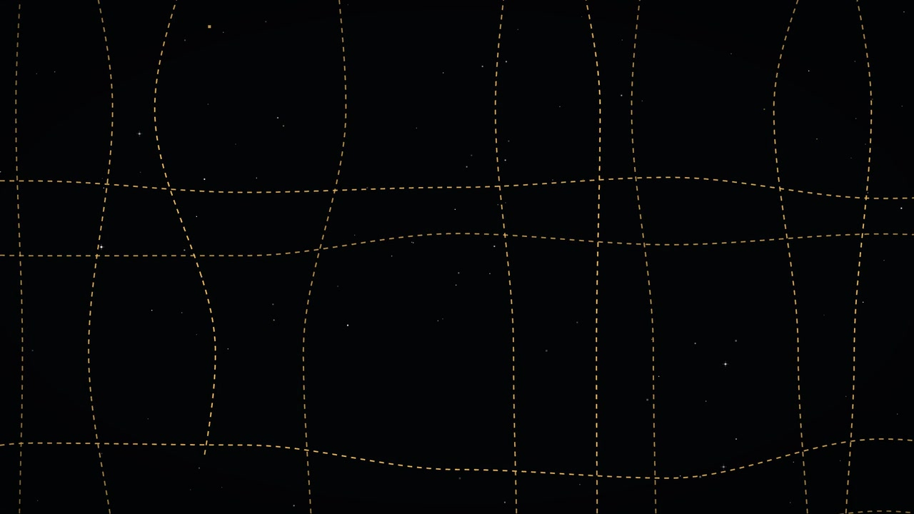
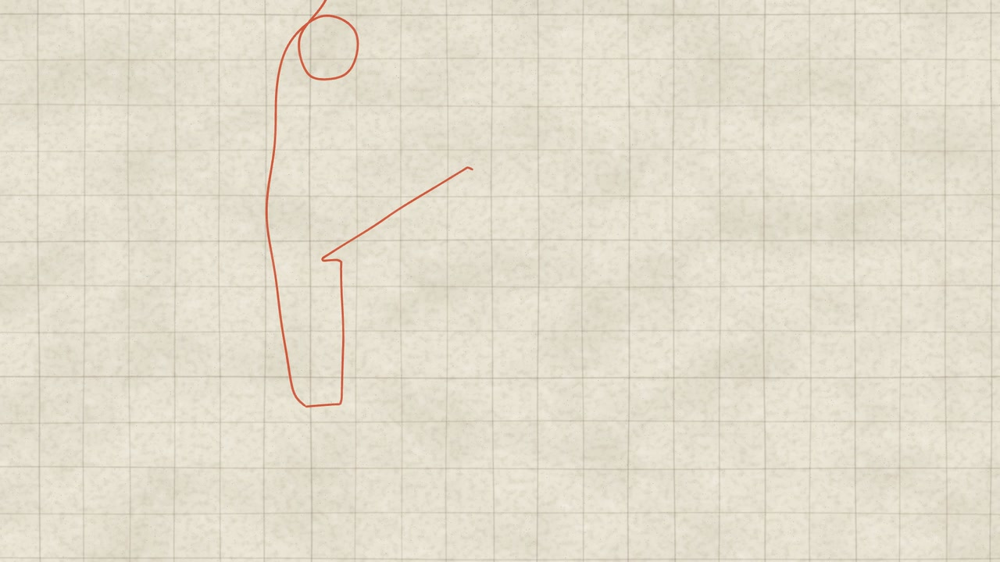
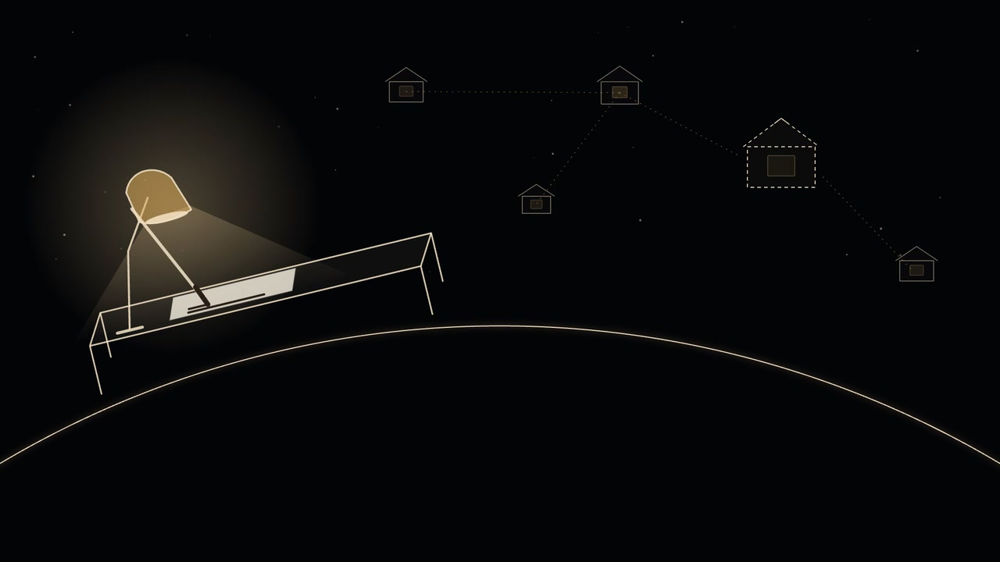

# 案例：阡陌宣传片

阡陌（一个智能体网络项目）的产品宣传片，纸面二维动画，没有旁白。诗句字幕取陶渊明《桃花源记》：序章「林尽水源，便得一山。山有小口，仿佛若有光」，从一只目镜望出去；之后几幕是纸上的田埂、屋舍和村落，一根红线贯穿全片，把一户户人家连起来；终章「阡陌交通，鸡犬相闻」落到晨光。

三部片里这一部轮次最多：R1–R20 加 U90–U90j，共三十轮，从 Remotion 起家，中途换成自写渲染器，配乐从合成走到真实采样，再压成一支 90 秒的上传版。agentreel 的 `engines/paper2d` 和 `music/sampler` 都从这部片整理而来。

*R20 第 400 帧（网格第 320 格，5.1），幕间交接 H0。序章末尾目镜在 10 帧内滑出画面，露出同一片不放大的平原：俯视的夜色里，田埂是一条条暖色虚线。这是标题幕的第 0 帧，与序章最后一帧逐像素相同（颗粒除外）。整幅由代码绘制。*

## 轮次与规格

所有版本都是 72 BPM、4/4，时序写在 24 格网格上（一拍 20 格，一小节 80 格）。

| 轮次 | 时间 | 长度与规格 | 这一轮做了什么 |
| --- | --- | --- | --- |
| R1–R3 | 建仓库之前 | 24 fps，32 小节，2560 帧，约 106.7 s | 目镜序章、纸上一户人家、青花一幕等第一版成片，Remotion 渲染 |
| R4 | 09-28 起 | 24 fps，34 小节，2720 帧，113.3 s | 拆参考片（见下），二维手作感全面加强；负责人当天连给多次意见，逐条落地 |
| Qianmo36 | 09-29 前后 | 30 fps，36 小节，120 s | 第一次输出 30 fps：画面仍写在 24 格上，输出帧 n 显示网格 0.8n；配乐 v6 起连续重写 |
| R5–R7 | 10-06 至 10-08 | 30 fps，41 小节，4100 帧，136.67 s | 内容随项目进展更新：一幕加长、新增一幕（共 41 小节），幕间交接点从 H0–H5 扩到 H0–H7 |
| R8–R19 | 10-08 | 同上 | 只改配乐（v16–v27），画面视频流原样复用；从 R10 起另记 155 个视觉源码文件的指纹 |
| R20 | 10-10 | 同上 | 只改两句状态文字 |
| U90 | 10-10 | 30 fps，26.5 小节，2120 格，2650 帧，88.33 s | 90 秒上传版：不剪原片、不变速，每幕按原速重排节拍；自写渲染器；配乐按新时间线重编 |
| U90b–U90j | 10-11 至 10-17 | 同上；U90j 片前加 49 帧黑场卡，2699 帧，89.967 s | 每轮只改一幕或片尾的画面与文字，片长、配乐、幕边界、交接帧都不动 |

交付形态（U90j）：1080p 无声画面母版 x264 CRF 15；审片版直接复用母版视频流、混 AAC 256k；按上传平台的规格另出一个小码率版本；另有 1080p 分享版。U90j 的各个文件，音视频流都从 0 起、长 89.966667 s，在 90 秒以内。

## 技术路线

**从 Remotion 到自写渲染器。** 场景一直是 React 组件，按 Remotion 的 API 写。10-10 负责人要求把 Remotion 和同类框架从本机删掉、不得重装，但已有的几十个场景文件不能重写，于是做了三件事：

1. 写一个垫片模块，实现场景实际用到的那部分 API（帧号、合成、序列、插值、弹簧、静态资源等）；
2. 用 Bun 打包时把裸模块名 `remotion` 指到垫片，场景代码一行不改；
3. 无头 Chrome 打开打包后的页面，经 CDP 逐帧截图，按帧序直接写进 ffmpeg，不落临时图片目录。

验收是拿新渲染器重渲 R5 组合，对 Remotion 时代的 R20 母版逐帧比：全片每 7 帧取一张（586 帧，覆盖 0.8n 的全部五种小数相位），RGB 最低 38.43 dB、Y 最低 41.97 dB；把自己的帧走一遍当年的编码管线再比，差都在 0.35 dB 以内，剩下的就是编码损失。过程中查出三处差异并修掉：小数帧上的弹簧不在精确曲线上（一张卡片偏 4 px）、页面缺 `box-sizing: border-box`（卡片里的行掉出卡外）、帧冻结的浮点算术（颗粒错位）。（这是当年那份垫片的验收。agentreel 的 `engines/paper2d` 垫片已经重写：接口与 Remotion 兼容，数值在 `spring`、`random` 等处可能与 Remotion 不同，不能拿它去对 Remotion 渲的母版。）U90 全片 2650 帧，6 个标签并行、PNG 截图，151 秒渲完（17.55 帧/秒）。

**24 格网格上的 30 fps。** 画面的全部时序写在 24 格上，30 fps 输出时把整个画面包进一个换算层：输出帧 n 显示网格 0.8n。72 BPM 在 30 fps 下正好一拍 25 帧，所以拍点仍在整帧上；手绘段的「一拍二」也在这层里换算。

**纸面语言。** 纸色 #F3EADB、墨 #201E1D、赭 #C67139；红线是全片的连续主体，背景可以翻转，线始终在。批注线、圈注、箭头都用手绘笔触（粗细起伏、收笔有锋、干笔飞白），线条每 3 帧重画一次不超过 0.6 px 的微抖（boil），给静止段一点生命。字幕逐字出现，字幕在画面上时动作让位。

*R20 第 745 帧（网格第 596 格，8.2+16 格），第二幕开场。纸色网格纸上，贯穿全片的那根红线从画面上方垂下来，打一个结，开始画第一间屋子的墙和屋顶。线条和纸面都由代码绘制，这时还没有字幕、卡片和标签。*

**幕间不切，只交接。** 每两幕之间写死一张交接帧（见 [`../templates/HANDOFF.md`](../templates/HANDOFF.md) 的 B 部分），上一幕最后一帧与下一幕第一帧逐像素相同（颗粒除外），靠一个共享元素把镜头带过去：一盏光点涨满成纯纸色、一张卡片缩成一滴钴蓝再洇成屋舍、一根细线伸出画面弯成地平线弧。

*R20 第 3130 帧（网格第 2504 格）。R5 起加的一幕：夜里一张书桌、一盏灯，远处几户人家用虚线连着；底下那条弧就是终章的地平线弧，已经提前在画面里。全部是代码画的线条。U90 压到 90 秒时，这一幕整段删掉了。*

**向参考片学方法。** 拆了三支产品片（86 s、74 s、41 s），逐帧差分加条带抽帧，只记数字和手法：硬切极少（分别 6、7、5 刀）；40–48% 的帧几乎静止，那是给观众读的时间；两个大动作之间隔 51–85 帧，约等于 72 BPM 的一小节，所以定了「每小节一个主动作」；起步 1–4 帧到峰值速度，落定 8–14 帧，不回弹。参考片的画面、声音、文字都不进成片，下载的文件不进仓库。

**材质蒙太奇的光敏规则。** 间隔不超过 5 帧的快切段里，相邻两张的平均亮度差不超过 10%，不做大面积饱和红的闪烁，每段急速切不超过 1.5 秒；图片按亮度渐变排序。

## 配乐

**从合成到真实采样。** 早期配乐是减法合成加采样钢琴。负责人听 v6 说「不行，要高级而有质感，而且具有生命力，现在那个叮铃的声音一股 ai 味道」，之后改用真实采样乐器，全部是 CC0、公有领域或 CC-BY 素材，下载前逐条用接口读许可，署名写进素材清单：

- 钢琴：Salamander Grand Piano V3（CC BY 3.0）；
- 弦乐、木管、圆号、定音鼓：VSCO 2 Community Edition（CC0）；
- 民间乐器与打击乐：VCSL（CC0）；
- 女声：VocalSet 1.1（CC BY 4.0），切成音符单元，用 WORLD 分析再合成，改音高、拼接；
- 野外录音与画面里的物件声：Wikimedia Commons 与 Freesound 上的 CC0 / 公有领域 / CC BY 文件。

**意见会来回。** 负责人听 v10：「鼓掌的声音很廉价，我希望是钢琴，吟唱」，于是去掉鼓和拍手，改成钢琴加女声；听 v12：「与真正的产品发布的音乐不同」，v13 按发布片的律动加了全套鼓；听 v13：「不要架子鼓」，v14 起不再用。R15 采纳「每张图片一个音」，R17 又撤销，改成跨越多张快切的长乐句。这些都说明旧版要留着、改动要可逆。

**用测量找差距。** 负责人说「不高级」时，先把参考片和自己的版本用同一套方法量：10 kHz 以上的能量（v10 比参考片亮 7–20 dB，来自拍手、沙锤和提亮的均衡）、节拍强度、低频占比、每秒起音数、切点落在起音上的比例、段落接缝处的响度跳变。还量出采样钢琴的两声道在旋律音区几乎反相，单声道外放时互相抵消，于是给钢琴加了「按最大相关时差对齐两声道」的选项。

**U90 重编配乐。** 90 秒版不能简单删段：每幕按原速重排，蒙太奇换了切点。做法是：

1. 先证明现有配乐能完整复现：v27 是四次独立运行接力出来的（每级写 24-bit 分轨交给下一级），按原顺序重跑，43 个中间分轨全部与锁逐字节一致，成品 SHA-256 与 v27 相同；
2. 写一个「源模型」，把 v27 的全部事件原样取出，把依赖画面锚点的二次加工拆回成规则；
3. 写一个编排方案，把源事件按新时间线的锚点重新安排；
4. 合并成一个渲染器一次跑完四级。拿恒等时间线跑，输出与 v27 逐样本相同（6,560,000 个样本，最大差 0），才拿它出 U90 的配乐。

放弃的两条路：纯时间映射表达不了切点表和停留时长的变化；整体重写会离负责人听惯的 v27 越来越远，也没法证明工具没有走样。

## 只改该改的帧

这部片轮次多，每一轮都要证明没改的部分真的没变：

- R8–R19 只改配乐，画面视频流直接复用，视频 payload 哈希不变；从 R10 起另锁 155 个视觉源码文件的 SHA。
- U90b 起每轮对上一轮母版逐帧算 PSNR。例如 U90b 只改一幕，这一幕以外 2150 帧全部高于 40 dB，最低 45.24 dB，554 帧完全相同；R20 对 R19 也只有改了字的两段低于 40 dB。
- 交接帧每次都用 `magick compare -metric AE` 量差异像素数。
- U90j 在片前加黑场卡时不重渲正片：卡单独渲 49 帧，与正片母版无损拼接（两段的 SPS、PPS 逐字节相同，拼接后每帧的解码哈希等于两段各自的）；配乐前面补 49 帧的静音（78,400 个样本），其后的样本与原配乐逐字节相同。

## 关键决策

- **不剪原片、不变速。** 90 秒版每幕按原速重排节拍，能压的只有停留和过渡的长度，以及整拍拿掉；字幕一字不改，可见时长不少于「字数 × 3.2 格 + 16 格」。
- **生成图只用在两处。** 序章目镜的硬切材质和终章地平线弧；其余全部用代码画（SVG、canvas、CSS）。生图接口的密钥只放本机环境变量，不入库、不输出。
- **低帧率只给手作段。** 参考研究后一度把手绘段整幅降成一拍二，负责人看过后第二幕、第三幕改回 24 fps，只留落定时的放射短线一拍二。
- **画面锁定后再按新时间线编配乐。** 音效提示文件写网格帧号，配乐读字幕入点、蒙太奇切点、音效提示出谱。
- **盲测改字幕。** 无背景的读图代理只看静帧复述；有一句字幕被读偏了，于是改了措辞，而不是加解释。
- **负责人点名时，主会话亲自写镜头。** 10-07 负责人嫌书桌一幕里燕子的脚和衔信的挂法难看，要求「用最高规格你亲自来做，符合全片的风格」。主会话没有派子代理，自己重画了燕子（翅膀按扑动角投影成三维翼面；脚按栖点反解身体位置，趾尖正好落在灯罩顶和屋脊上），信改成挂在红线上、按单摆逐帧积分（只感受喙加速度的 30%，按全量算急转时会被甩过头顶），又挪了一座小屋、放低一段红线，让燕子、信和线不再穿过屋子。配乐和音效提示都没动。

## 教训

- **Chrome 合成层有历史。** 多标签并行时，同一帧的截图会和单标签不一样，因为合成层保留了前一帧的状态。办法是每帧先把合成隐藏再显示，强制重建合成层；之后单标签与 6、8 标签的截图只差 ≤ 1/255。
- **小数帧会暴露隐藏的假设。** 30 fps 换算后网格帧是小数：`t === 0` 一类的写法永远不触发，要改成 `t < 1`；弹簧要在精确曲线上取值；冻结帧的换算不能有浮点误差。
- **参数是帧区间还是进度。** 一个 `ramp()` 工具函数按帧区间写，有人拿它插 0..1 的进度值，卡片上的小字就只显示到 10%。
- **没有 GPU 时换后端，但别拿它比像素。** ANGLE + SwiftShader 能跑 WebGL2，但与本机 GPU 后端同一帧平均差约 7/255；交接帧逐像素比对必须在同一后端上做。
- **大文件进 LFS，推之前确认真上传了。** 只有指针的采样和材质在另一台机器上无法出图，也无法重渲配乐。
- **AAC 有起始预留。** 成片音轨比 WAV 晚约 42.7 ms，是编码器的 priming；量同步时要把它算进去。
- **两遍编码重跑结果可能略有不同。** 上传版、分享版的 x264 两遍编码不保证逐字节复现，交的就是那一次的产物，哈希记下来。

## 在 agentreel 里

- 引擎：[`engines/paper2d/`](../../engines/paper2d/README.md)。自写渲染器与 Remotion API 的兼容垫片（已重写，接口兼容，`spring` 等处的数值可能与 Remotion 不同）、静帧与整段渲染、逐像素比较、相邻帧差扫描、保真检查，以及纸面、铅笔线、红线、逐字字幕等通用组件；命令改成按片目录打包，产品硬编码去掉，见该目录的 README。
- 配乐库：[`music/sampler/`](../../music/sampler/README.md)。采样乐器、人声再合成、混音与检查工具；采样本身不入库，由 `fetch_samples.py` 按清单下载并核对许可，署名文本在 `CREDITS.md`。
- 示例片：[`films/demo-paper/`](../../films/demo-paper/README.md)。
- 没有搬：这部片的场景程序、产品界面与形象、事实与文案来源、参考片和参考图、采样文件、生成的材质图、各轮成片。
