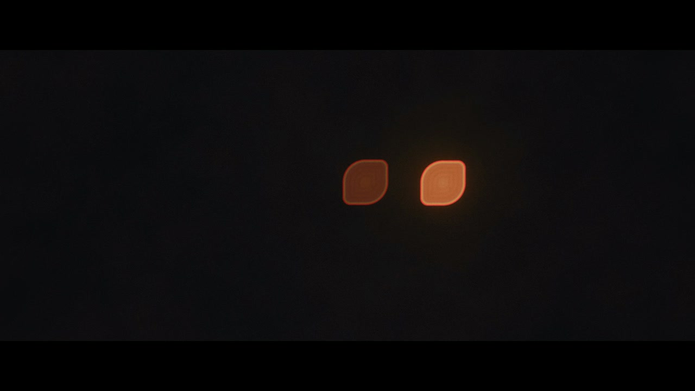
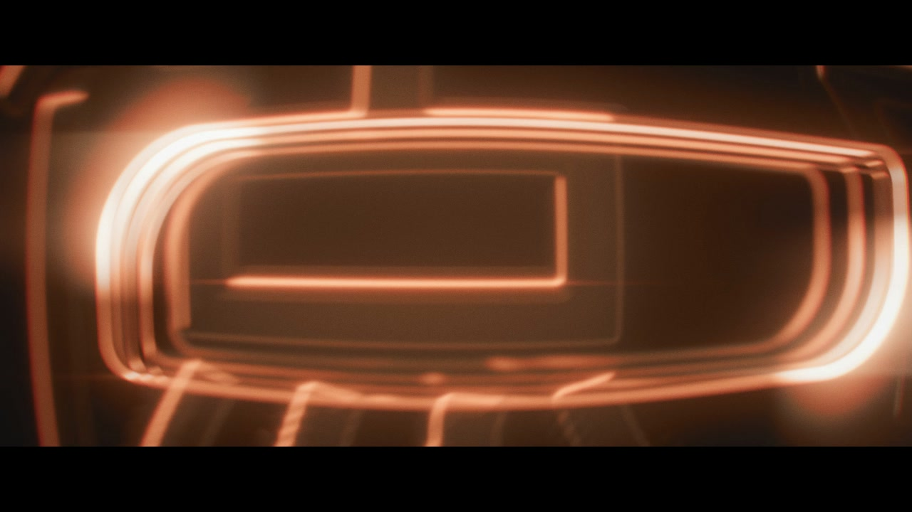
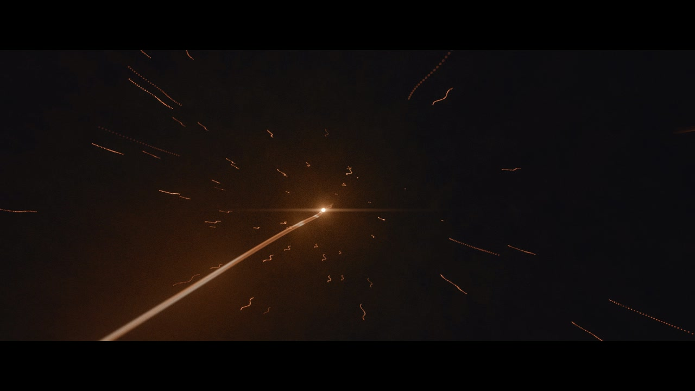

# 案例：《一拍》ONE BEAT

一款即时通讯应用的宣传片。一条消息从「嘀」到「嗒」，现实里只要几百毫秒；整片是这一拍的慢镜头：镜头钻进服务端进程，看它怎样把消息同时放行到各个平台，最后恢复真实速度，「嗒」。

画面引擎与配乐库移植自《成路》，agentreel 里的 `engines/beat3d` 和 `music/filmsynth` 以这部片的版本为主线整理而成。

*S01 正在输入，2.2+8f（第 88 帧）。远处两点光是镜头光圈本身的像：光圈做成叶形，所以光斑是叶形，一枚亮、一枚暗，按拍交替。这是全片的签名细节，后面玻璃的虚化、光字的预虚化都用同一个光圈核。*

## 规格

| 项 | 数值 |
| --- | --- |
| 长度 | 34 小节画面（90.67 s）加 1 小节余音，共 35 小节、2240 帧、93.33 s |
| 帧率与速度 | 24 fps，90 BPM 固定，每拍 16 帧、每小节 64 帧 |
| 镜头与同步 | 14 个镜头，12 个硬同步点 |
| 画幅 | 抽象世界 2.39 遮幅；16.1 硬切到真实屏幕时一刀打开到 16:9，之后不再收回 |
| 母版 | 1920×1080，H.264 High CRF 16，AAC；分享版 1280×720，x264 slow CRF 20（maxrate 6M）、AAC 192k、faststart，对母版缩放后 SSIM 0.985 |
| 响度 | 成片音轨 −16.1 LUFS，LRA 15.4 LU，真峰值 −1.3 dBFS（本文档整理时用 `ebur128` 复测一致） |
| 渲染 | 全片 2240 帧 20.7 分钟，三个标签共用一个 GPU 进程，墙钟 552 ms/帧（本机 Apple M 系列，Chrome，ANGLE Metal） |
| 没做 | 4K 母版（渲染时间约 4 倍，导演本只要求 1080p） |
| 周期 | 同一天内完成：样张 A 开工、样张基线、全片第一版、全片终调，共三次提交 |

## 结构

冷开场（两枚「正在输入」的光）→ 嘀（玻璃气泡落下）→ 镜头穿过玻璃进入请求 → 进程内部一镜到底（几个房间，每过一道门是一拍，拍子越分越细）→ 放行前 1.33 秒全静 → 五根光弦同时拨响 → 硬切到真实屏幕 → 拉远 → 多等一拍 → 嗒 → 片尾。

速度始终 90 BPM。进程段的「加速」靠拍子越分越细（四分 → 八分 → 三连 → 十六分），画面网格始终整齐。

## 技术路线

**画面（beat3d）。** Bun + TypeScript + three.js 自写渲染器，无头 Chrome 多标签并行出帧，ffmpeg 编码拼接。一帧只依赖帧号；文字也在 WebGL 里（字体用 FontFace 加载，Canvas2D 栅格化成纹理）。这部片在《成路》引擎上加的主要能力：

- **叶形光圈**：光圈形状与光圈内亮度分布定义一次，点光源光斑、图层景深、光字图集的预虚化都用它，弥散圆都来自同一个薄透镜公式。
- **分层景深**：后期只有一张深度时，玻璃边、半透明和雾都会漏边，所以改成每个图层按自己的平面算弥散圆，再三层合成（背景、图层、前景）。
- **体积雾与微尘**：点光源单散射加相函数，按深度消光；无光处按实测校准显示为墨色。
- **光丝文字 ThreadFlow**：光聚成字、字化为光，路径改到 3D，丝带按弥散圆加宽并保持能量。
- **穿玻璃**：镜头进入玻璃的 8 帧由一个合成程序完成（桶形畸变、笔画背面、倒角高光、焦散细丝、曝光涌起），全部光作为一个量经同一条暖色坡上色，所以只有主色和暖白。
- **胶片后期**：子帧累加的运动模糊、辉光金字塔、晕光、变形拉丝、单向暖色色差（不减通道，避免白字出蓝边）、AgX 调色、颗粒、三角抖动、遮幅。
- **真实录屏进 3D**：录屏预先抽成无损逐帧图片，按帧号精确取帧；屏幕颜色按后期调色反算查找表，深色界面不发灰。录屏只许裁切、缩放、调色、放进空间，不许改界面或重做动画。

*S03 起点，5.1+3f（第 259 帧）。镜头正在穿过玻璃气泡：倒角的高光条从画面边缘扫过，内反射线交叉成焦散细丝，色相只有主色和暖白。*

**配乐（filmsynth）。** 全部由代码合成，不用录音、采样、外部冲激响应和生成模型，没有署名义务。

- 调性 E♭ 大调；动机只有一呼一应：嘀 = B♭，嗒 = E♭，一个下行纯五度。打字音、有音高的动机、脉冲都只用这两个音级。
- 新写的乐器：毛毡弱音钢琴（模态合成，谐波分音、三根同度弦的拍频、两段衰减、毛毡低通），以及一根被拉紧的合成弓弦（音高从低处升到写的音，用在五根光弦上）。
- 硬同步做法：H1 毛毡琴与次低频同帧进入；H2 反向涌起的峰在 5.1 前 2.5 帧，低频冲击晚 0.73 帧；放行前 14.3–15.1 完全静音（最大样本为 0）；15.1 是全片唯一一次大的低频冲击；五个到达音对齐画面上消息出现的那一帧。
- 画面读配乐导出的 `events.json`：S01 的光斑按打字事件明灭，S03 的光脉冲按 `pulse` 事件沿梁跑，五根弦按 `pluck` 事件振动。

*S08 放行，15.2+8f（第 920 帧）。五根弦同时被拨响之后，镜头甩到最近的一根上追着脉冲冲出去：拖影、运动模糊、变形拉丝。*

## 分路与轮次

| 代号 | 做什么 | 轮次 |
| --- | --- | --- |
| P1 | 引擎落地（自《成路》移植）、样张 A 画面（S01–S03） | 第一轮打回（构图长时间不动、气泡像按钮、穿入是米灰色径向模糊、飞字像模板）；第二轮通过，留 6 条打磨清单 |
| M1 | 配乐库落地、样张 A 配乐 | 一次通过。负责人试听后的原话："The music direction works; keep it." |
| P2 | 引擎负责人；进程段与拉远段（S04–S08、S10–S11） | 交付全片第一版；终调时暗部色相被打回 |
| P3 | 真屏、多等一拍、嗒、片尾（S09、S12–S14） | S14 通过；S12 第一轮打回（玻璃比 S02 平）；S09 第二轮打回（五屏太小、看不清到达），第三轮通过 |
| R1 | 真实素材与事实：录屏、实测、核对 | 第一拍次缺一路接收动画；负责人同意让出电脑后补拍，第二拍次替换 |
| M2 | 全片配乐（在样张 A 上扩展），之后两次按真实到达时刻重渲 | 通过；样张 A 部分始终逐样本不变 |
| 终调 | GradeOne（S01–S03）、GradeProcess（S04–S08）、GradeFile（S10–S11）三路并行 | GradeOne 第一轮把光调成琥珀色被打回，第二轮通过；其余一次通过 |

主会话做编剧、分镜、任务书、审片和总验收，不写镜头程序。引擎核心归 P2；P3 需要核心改动时把补丁交给主会话转达。制作当天三次撞到额度中断，主会话把各代理的上下文摘要抽成交接文件，新代理按原任务书续做。

## 关键决策

- **沿用自写引擎，不用视频框架。** 《成路》的引擎已经有这部片要的电影后期，复制过来只删用不到的部分，不留死代码。
- **速度 90 BPM 固定**，选它是因为 24 fps 下一拍正好 16 帧。
- **叶形光圈做成全片签名**，两枚光斑用同一片叶形（一支镜头只有一个光圈形状），区分靠位置和节奏。
- **一个连续空间**：进程段 7.1–16.1 一镜到底，拉远段 19.1–25.1 一镜到底；每个房间的尺度、密度、运动方式各不相同，不把同一个长廊复制五遍。
- **16.1 的处理**：从放行的最强音硬切到真屏，变成近乎无声的「慢动作屏息」，只剩五下轻敲，暖和弦稍后进来。
- **真实性**：片中数字一律取自真实测量，照录、不换口径，并带一行诚实的小注；数据没到时画醒目的占位，不准编。真实录屏里 App 自己的小瑕疵照原样保留，不冻结、不补拍，在报告的「已知」里写明。录屏只按窗口录，不录整屏。
- **禁蓝的范围**：只管片子自己画的光和图形；真实录屏里界面本身的颜色不算违规。
- **终调的护栏**：已定稿的四个镜头不动，它们依赖的共享后期默认值、着色器、镜头后期参数也不准改；终调只能在各自程序里改光、材质和本程序的后期。

## 教训

- **工程项全过不等于通过。** 样张 A 第一轮时间、同步、确定性、色带、禁蓝全部合格，画面仍被打回。打回意见写成逐镜指令，并给出自审标准（三张静帧放进顶级发布片里不能掉档次）。
- **先量再调。** 「铜色单调」是主会话写了逐镜色调检查之后才量出来的：中段六个镜头的暗部偏品红到正红。标准定成三档之后，各路才有了共同的目标；第一轮终调又暴露出光色漂向琥珀，于是加了第三档。
- **缺数据就报错。** 配乐代理发现旧代码在缺少到达数据时会悄悄退回同一帧，改成报错退出。
- **回归要固定 worker 数。** 渲染按 worker 切段分别编码，worker 数不同解码后的像素就不同；样张回归必须和参照用同样的 worker 数。
- **黑要真黑。** 调色的 lift 经 sRGB 后约 4 个码值，再叠颗粒，片头的「全黑」是灰黑；改成场景里有光时才加 lift。
- **接缝要量。** 两个程序一镜到底对接时，接方 import 被接方的舞台和外观，不抄；接缝两侧帧差和本镜自己的相邻帧差比。
- **中断随时会来。** 要求续派代理边做边把工作日志追加进报告；中断摘要和补丁都落成文件。
- **听感只能负责人判断。** 主会话和代理都听不到；每份配乐报告都写「未经人耳试听」，并列出最担心的三处请负责人戴耳机听。

## 在 agentreel 里

- 引擎：[`engines/beat3d/`](../../engines/beat3d/README.md)。叶形光圈改成可选的光圈形状（圆、叶形、多边形，由片子在 `FilmDef.aperture` 里给），品牌色与字标移出引擎。
- 配乐库：[`music/filmsynth/`](../../music/filmsynth/README.md)（《一拍》加的 `FeltPiano`、`TautString`、干切与 `s.event()` 都保留）。
- 示例片：[`films/demo-light/`](../../films/demo-light/README.md)，用同一套做法演示光圈虚化、光聚成字、画幅跳变和按乐谱事件驱动画面。
- 没有搬：这部片的镜头程序、产品界面、真实录屏、事实数据与请求抓包。
